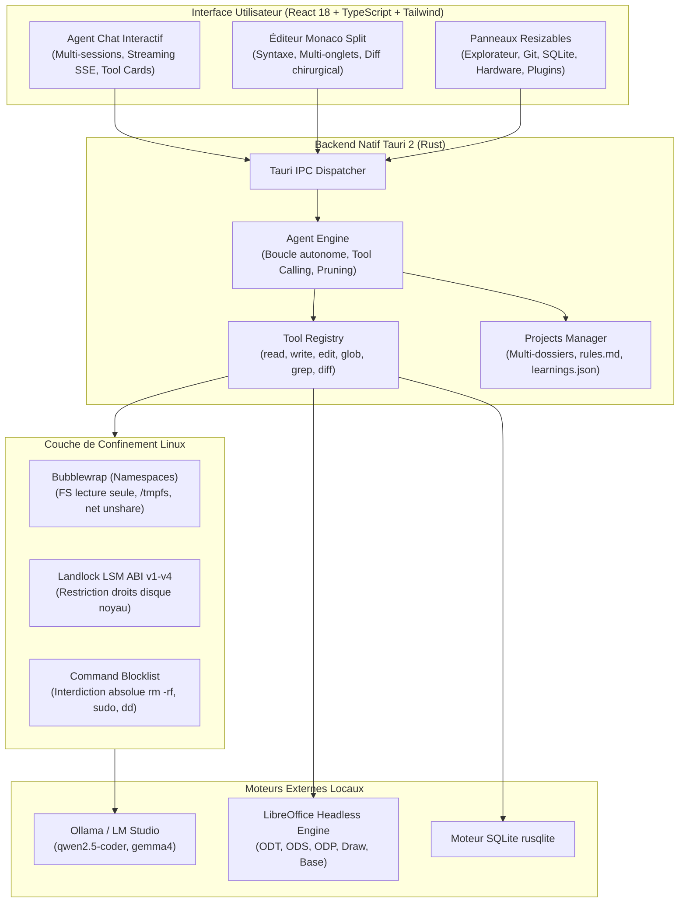

# ⚡ Singular Code — Local Autonomous AI Code Agent & IDE

<div align="center">


### *L'Environnement de Développement Autonome 100% Local, Privé et Sécurisé pour Linux*

[](LICENSE)
[-green.svg)]()
[](https://tauri.app/)
[](https://www.rust-lang.org/)
[](https://react.dev/)
[](https://microsoft.github.io/monaco-editor/)
[]()
[](https://ollama.ai/)
[](https://www.libreoffice.org/)

**Singular Code** est une alternative souveraine, open source et totalement déconnectée du cloud aux assistants de code propriétaires (Cursor, Claude Code, Windsurf, GitHub Copilot Workspace). Conçu pour fonctionner directement avec vos propres modèles LLM locaux (Ollama, LM Studio, llama.cpp, vLLM) sur GPU RTX ou CPU, il combine une suite complète d'outils de développement dans un bac à sable Linux ultrasécurisé.

[Fonctionnalités](#-fonctionnalités-majeures) • [Sécurité Noyau](#-architecture-de-sécurité-renforcée) • [Suite LibreOffice](#-suite-bureautique-libreoffice-intégrée) • [Installation](#-installation--démarrage-rapide) • [Commandes Slash](#-commandes-slash--raccourcis)

---

</div>

## 🌟 Pourquoi Singular Code ?

1. 🔒 **Confidentialité Absolue (Zéro Télémétrie Cloud)** : Votre code propriétaire, vos clés et vos secrets ne quittent jamais votre machine. Tout s'exécute en local.
2. 🛡️ **Isolation Système au Niveau Noyau** : L'agent dispose d'une autonomie d'action complète, mais confinée dans un bac à sable Linux strict via **Bubblewrap** et **Landlock LSM**.
3. 🚀 **Inférence Locale à Haute Vitesse** : Optimisé pour `qwen2.5-coder:7b`, `1.5b` et `gemma4:e4b` avec gestion active de la VRAM GPU et déchargement instantané en un clic.
4. 📄 **Suite Bureautique LibreOffice Complète** : Création autonome de documents Writer (.odt), Calc (.fods/.ods), Impress (.fodp/.odp), Draw (.svg), Math (.mml) et Base (.sql).
5. 🧪 **Cycle TDD & Boucle d'Auto-Réparation** : Exécution de tests unitaires avec analyse et correction de code en boucle fermée sans intervention humaine.

---

## 🏛️ Architecture Technique



---

## 🚀 Fonctionnalités Majeures

### 🤖 1. Agent Autonome & 6 Modes de Collaboration
- **Boucle d'action itérative** : Recherche, lecture, écriture, modification chirurgicale, exécution shell et auto-correction.
- **Support hybride des outils** : Function calling natif OpenAI/Ollama et parser de repli robuste (JSON / Tool Call blocks) pour modèles compacts.
- **6 Modes d'opération** commutables instantanément :
  - `YOLO` : Autonomie maximale (création et édition immédiate sur le disque).
  - `CODE` : Biais vers l'implémentation directe de code propre et testé.
  - `ARCHITECT` : Planification structurée avec `todo_write` avant écriture.
  - `DEBUG` : Analyse d'erreurs, inspection de logs et application chirurgicale de patchs.
  - `REVIEW` : Mode audit de code avec génération de suggestions et diffs.
  - `ASK` : Demande d'approbation manuelle pour chaque opération de fichier ou commande.

### 🛡️ 2. Architecture de Sécurité Renforcée
- **Double isolation noyau Linux** :
  - **Bubblewrap (`bwrap`)** : Confinement dans des namespaces Linux dédiés (`--unshare-all`, `--ro-bind` sur le système, `$HOME` éphémère).
  - **Landlock LSM** : Restreint l'accès aux inodes directement depuis le noyau Linux (compatible ABI v1 à v4).
- **Confinement strict des chemins (`PathConfinement`)** : Élimination des failles TOCTOU, interdiction des traversées de dossiers (`../`) et verrouillage automatique des fichiers sensibles (`.env*`, `.ssh/`, `*.pem`, `*.key`).
- **Blocklist permanente absolue** : Blocage irréversible des commandes à risque (`rm -rf /`, `sudo`, `dd`, `mkfs`, fork bombs), y compris en mode YOLO.

### 📄 3. Suite Bureautique LibreOffice Intégrée
Générez et manipulez des documents pour l'ensemble des 6 applications LibreOffice :
| Application | Format Produit | Cas d'Usage |
|---|---|---|
| 📝 **LibreOffice Writer** | `.odt`, `.pdf`, `.docx` | Rapports techniques, spécifications, documentations et courriers |
| 📊 **LibreOffice Calc** | `.fods`, `.ods`, `.csv` | Feuilles de calcul, budgets, formules et tableaux de bord financiers |
| 📽️ **LibreOffice Impress** | `.fodp`, `.odp`, `.pptx` | Présentations et jeux de diapositives découpés par sections |
| 📐 **LibreOffice Draw** | `.svg`, `.odg` | Schémas d'architecture, organigrammes et diagrammes vectoriels |
| 🧮 **LibreOffice Math** | `.mml`, `.odf` | Équations et formules scientifiques au format standard MathML |
| 🗄️ **LibreOffice Base** | `.sql`, `.odb` | Schémas relationnels SQL (SQLite/HSQLDB), tables et requêtes |

### 🧪 4. Cycle TDD & Boucle d'Auto-Réparation
- Déclenchez `/tdd` pour lancer automatiquement la suite de tests du projet (`cargo test`, `npm test`, `pytest`, etc.).
- En cas d'échec, l'agent inspecte le `stderr`, localise les assertions fautives et génère un patch chirurgical jusqu'à ce que tous les tests soient verts.

### 💻 5. Éditeur Monaco Professionnel & Split View
- **Multi-onglets fluides** avec coloration syntaxique complète et numérotation relative/absolue.
- **Split Editor** : Scission verticale ou horizontale pour éditer deux fichiers côte-à-côte.
- **Vue Diff intégrée** : Comparaison côte-à-côte avec acceptation/rejet granulaire des blocs modifiés par l'IA.
- **Recherche & Remplacement Globaux** : Moteur multi-fichiers avec support Regex, respect de la casse et prévisualisation avant remplacement.

### 🗄️ 6. Inspecteur de Base de Données SQLite
- Explorateur de tables et de colonnes (types, contraintes `NOT NULL`, clés primaires).
- Éditeur de requêtes SQL intégré avec exécution instantanée et rendu des résultats dans un tableau paginé.

### 🌿 7. Contrôle de Source Git Natif
- Tableau de bord Git avec statut en temps réel (fichiers modifiés, ajoutés, supprimés).
- Staging/Unstaging granulaire (`git_stage_file`, `git_unstage_file`).
- Rédacteur de commits conventionnels (feat, fix, refactor) et gestionnaire de branches.

### 🧩 8. Système de Plugins & 24+ Compétences Expertes
- **Gestionnaire de Plugins** : Modules activables à chaud (Accélérateur GPU Ollama, Shield Bubblewrap, GameDev Godot 4, Suite LibreOffice, Tailwind Studio, Rust Miri, etc.).
- **Catalogue de Skills** : Compétences spécialisées injectant dynamiquement des directives expertes dans le prompt système de l'agent.

### ⚡ 9. Télémétrie Hardware en Direct & Gestion VRAM
- Sparklines temps réel affichant la consommation de VRAM GPU (NVIDIA RTX), l'utilisation GPU (%) et la RAM système.
- Bouton de **Déchargement Immédiat de la VRAM (`/unload`)** pour libérer 100% de la mémoire GPU entre deux sessions.

---

## ⌨️ Commandes Slash & Raccourcis

| Commande | Action |
|---|---|
| `/libreoffice <app> [nom]` | Générer un document LibreOffice natif (`writer`, `calc`, `impress`, `draw`, `math`, `base`) |
| `/tdd` | Exécuter la suite de tests avec boucle d'auto-réparation itérative |
| `/mode <nom>` | Changer de mode d'opération (`ask`, `architect`, `code`, `debug`, `review`, `yolo`) |
| `/rollback` | Annuler immédiatement la dernière transaction atomique multi-fichiers |
| `/undo` | Restaurer le dernier snapshot / checkpoint de sécurité |
| `/unload` | Décharger tous les modèles de la mémoire GPU (VRAM à 0 Mo) |
| `/skills` | Ouvrir le gestionnaire des compétences expertes |
| `/learnings` | Consulter et modifier la mémoire long-terme (`.localagent/learnings.json`) |
| `/compact` | Compacter l'historique des messages pour économiser les tokens |
| `/web <requête>` | Recherche web en direct via DuckDuckGo |
| `/git` | Ouvrir le panneau de contrôle de version Git |
| `/init` | Générer le fichier de configuration `AGENT.md` à la racine |
| `Ctrl + Shift + P` | Ouvrir la Palette de Commandes universelle |

---

## 📦 Installation & Démarrage Rapide

### 1. Prérequis Système (Linux)

#### Ubuntu / Debian / Pop!_OS :
```bash
sudo apt update
sudo apt install -y build-essential curl wget file libssl-dev libgtk-3-dev \
    libwebkit2gtk-4.1-dev libayatana-appindicator3-dev librsvg2-dev bubblewrap libreoffice
```

#### Fedora / RHEL :
```bash
sudo dnf install -y webkit2gtk4.1-devel gtk3-devel libayatana-appindicator-gtk3-devel \
    librsvg2-devel bubblewrap openssl-devel libreoffice
```

#### Arch Linux / Manjaro :
```bash
sudo pacman -S --needed webkit2gtk-4.1 base-devel openssl gtk3 libappindicator-gtk3 \
    librsvg bubblewrap libreoffice-fresh
```

### 2. Installer Rust & Node.js
```bash
# Rust
curl --proto '=https' --tlsv1.2 -sSf https://sh.rustup.rs | sh -s -- -y
source "$HOME/.cargo/env"

# Node.js LTS
curl -fsSL https://deb.nodesource.com/setup_20.x | sudo -E bash -
sudo apt install -y nodejs
```

### 3. Cloner et Lancer le Projet
```bash
git clone https://github.com/votre-compte/singular-code.git
cd singular-code

# Installer les dépendances frontend
npm install

# Lancer en mode développement (Rechargement à chaud)
npm run tauri:dev
```

### 4. Compiler le Binaire de Production
```bash
npm run build
cd src-tauri
cargo build --release
```
Le binaire optimisé se trouvera dans `src-tauri/target/release/local-code-agent`.

---

## 🤖 Modèles Recommandés (Ollama)

Pour des performances optimales sur une carte graphique de type RTX 3060 / 4060 :

```bash
# Modèle principal recommandé (Qualité maximale de code & tool calling)
ollama run qwen2.5-coder:7b

# Modèle ultra-léger pour micro-tâches ou CPU
ollama run qwen2.5-coder:1.5b

# Modèle multimodal pour l'analyse d'images locales et maquettes
ollama run gemma4:e4b
```

Dans les paramètres de Singular Code :
- **URL API** : `http://localhost:11434/v1`
- **Modèle** : `qwen2.5-coder:7b`
- **Taille de contexte (`num_ctx`)** : `32768`

---

## 🧪 Tests & Qualité de Code

Le projet intègre une suite de tests unitaires et de confinement de sécurité :

```bash
# Lancer tous les tests du backend Rust
cd src-tauri
cargo test

# Vérifier le build TypeScript & Vite
npm run build
```

---

## 📄 Licence
Ce projet est distribué sous licence open source **MIT**. Consultez le fichier [LICENSE](LICENSE) pour plus d'informations.
# Singular-Code
